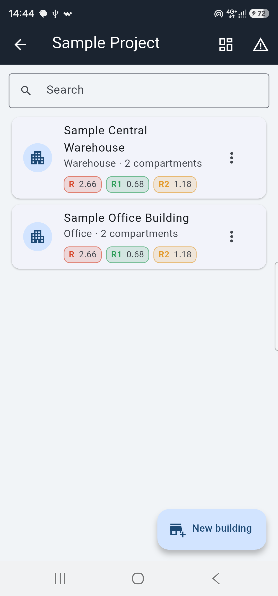
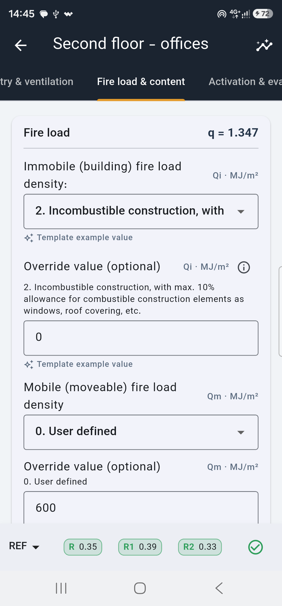
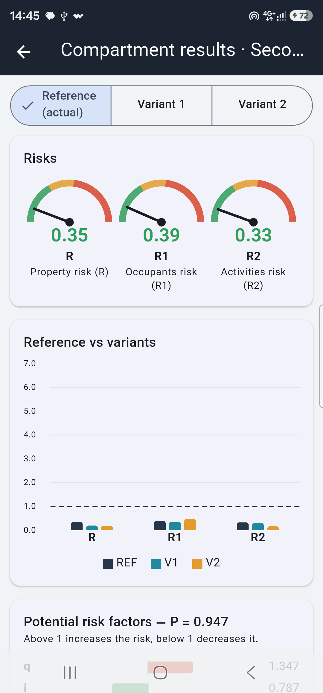
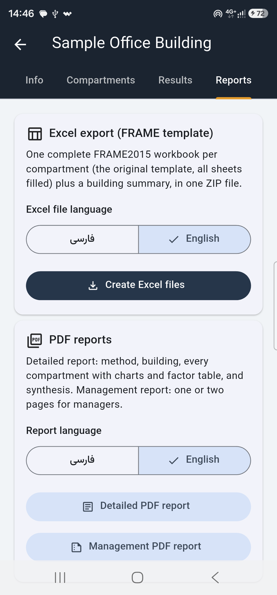
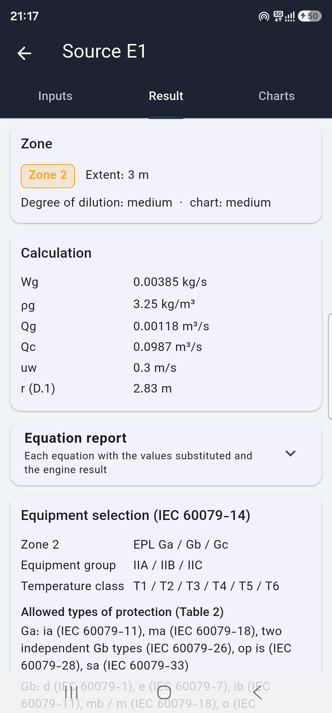
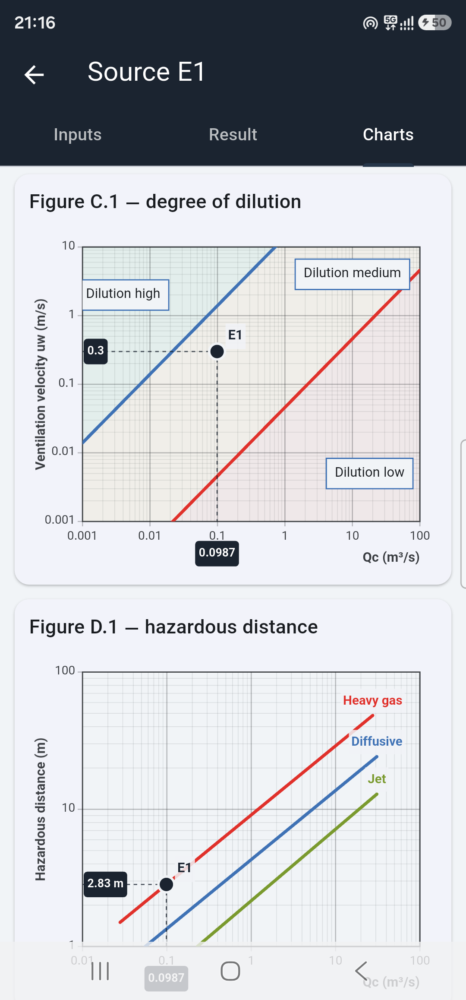
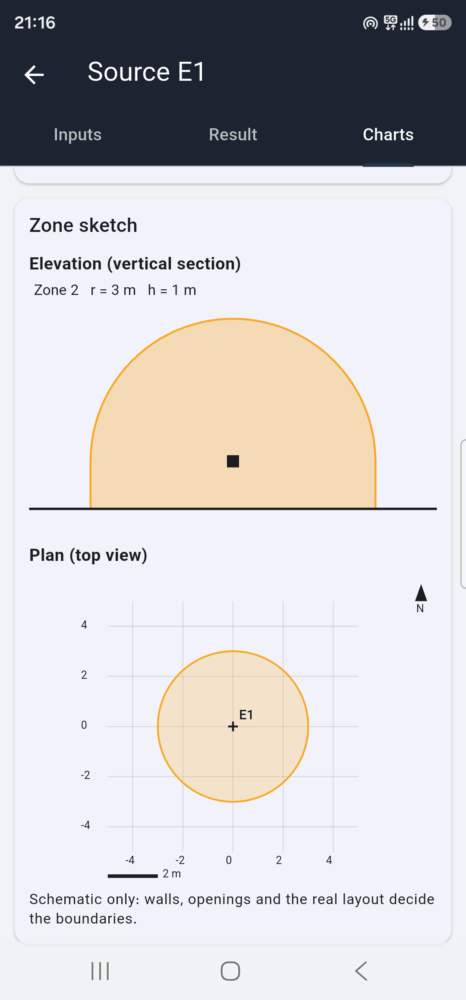
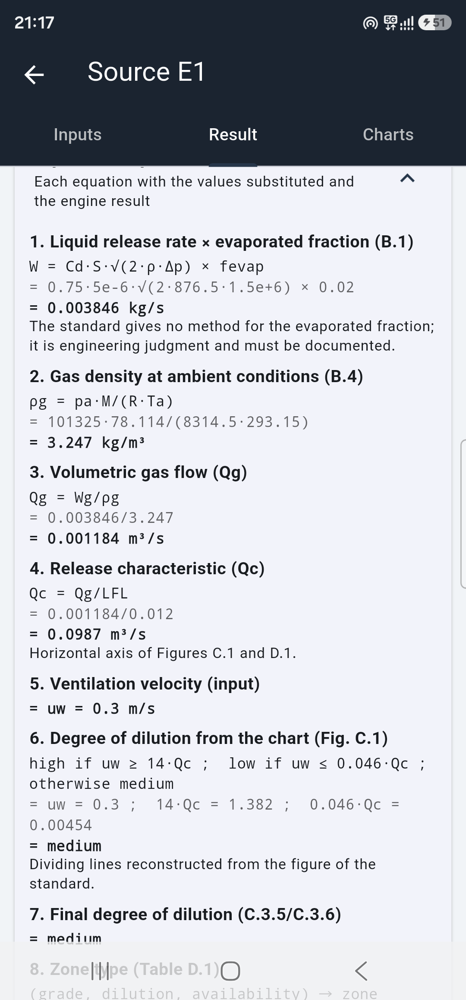

# FRAME Fire Risk & HAC Zones — Android apps

Two free, offline Android apps for fire-safety, process-safety and HSE engineers.
Both apps are bilingual (English / Persian) and work on phones and tablets.

## ⬇️ Download

**[Latest release → download the APK files](https://github.com/yousefi-nigc/frame-hac-apps/releases/latest)**

| App | File | Version |
|---|---|---|
| FRAME Fire Risk | `FRAME-1.0.2.apk` | 1.0.2 |
| HAC Zones | `HAC-1.1.0.apk` | 1.1.0 |

In Iran the apps are also on Cafe Bazaar:
[FRAME](https://cafebazaar.ir/app/ir.frame.hamadan.frame_app) ·
[HAC](https://cafebazaar.ir/app/ir.gastop.hac).
A web version of HAC runs at [gastop.ir](https://gastop.ir).

### How to install
1. Download the `.apk` file on your Android phone (Android 7.0 or newer).
2. Open it. Android asks you to allow installing apps from this source (your browser or file manager); allow it.
3. Tap **Install**. Android may warn that the app is not from Google Play; this is expected.

The same app installed from Cafe Bazaar and from this page is the same build, signed with the same key, so updates work either way.

---

##  FRAME Fire Risk

Building fire risk assessment with the **FRAME 2015** method of Erik De Smet.

- Projects, buildings and several fire compartments per building
- Inputs exactly as in the official FRAME2015 workbook
- Property risk (R), people risk (R1) and activities risk (R2) for the reference case and two improvement variants
- Charts comparing compartments and buildings, with the dominant factors
- Excel export that looks exactly like the FRAME2015 workbook, fully filled in (English or Persian)
- Detailed and management PDF reports
- Import compartments from filled FRAME2015 Excel workbooks
- Fully offline, no account; backup and restore; building photos

FRAME and the FRAME2015 workbook are © Erik De Smet, used with his permission.

---

##  HAC Zones

Hazardous area classification for explosive **gas** (IEC 60079-10-1:2020) and **dust** (IEC 60079-10-2:2015) atmospheres.

**Gas**
- Release rates for gas, liquid, evaporating pools or a known rate (Annex B)
- Degree of dilution (Figure C.1), zone type (Table D.1) and zone extent (Figure D.1)
- Outdoor and indoor, natural and mechanical ventilation, availability, background concentration
- Library of 329 flammable substances from ISO/IEC 80079-20-1
- Equipment selection per IEC 60079-14: EPL, equipment group and temperature class
- Zone NE (clause 4.4.2), flashing liquids (LPG), flammable mists (Annex G), gauge pressure
- Combined zones, releases in one enclosed space (B.4), plot plan and project dashboard
- Step-by-step equation report and engineering judgements checklist

**Dust**
- Zones 20, 21, 22, layer zones from housekeeping, dust group IIIA/IIIB/IIIC
- Maximum equipment surface temperature for clouds and layers (IEC 60079-14)
- Hybrid gas + dust mixtures, personal dust library

**Reports:** PDF (English or Persian) with data sheets, charts, plan and elevation sketches and the equation report; filled Excel workbooks.

The substance library is published with the permission of the Iranian National Standards Organization.
This tool supports, but does not replace, a classification study by a competent person.

---

FRAME Fire Risk: developed by Ganjineh Bargh Parsian. HAC Zones: developed by Nemat Yousefi Khanghah · [gastop.ir](https://gastop.ir)
Feedback and bug reports: open an [issue](https://github.com/yousefi-nigc/frame-hac-apps/issues).
